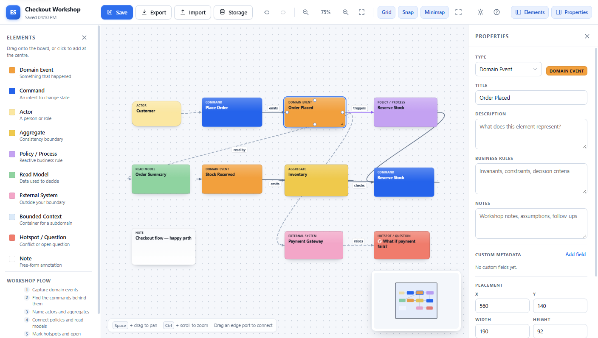
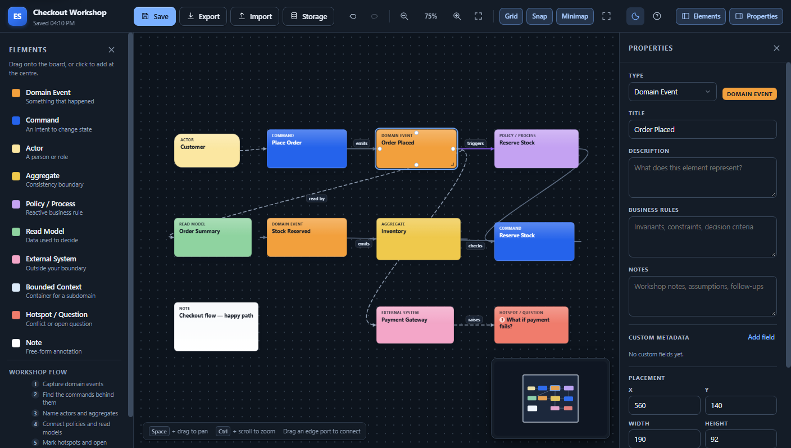

# Event Storm Board

**A standalone Event Storming workspace for domain-driven design workshops.** An infinite canvas with
sticky-note elements, SVG connections, groups, undo/redo, autosave, JSON import/export, dark mode and
keyboard-friendly workflows — built with pure HTML5, CSS3 and vanilla JavaScript.

No frameworks. No build step. No backend. No dependencies. Open the app and model.

[](https://khaledfathy-dev.github.io/event-storm-board/)
[](LICENSE)
[](https://developer.mozilla.org/docs/Web/JavaScript)
[](#run-locally)

### [Open the live app →](https://khaledfathy-dev.github.io/event-storm-board/)



<details>
<summary>Dark mode screenshot</summary>



</details>

---

## What is it?

Event Storming workshops usually begin on a wall covered in sticky notes. This project keeps that
direct, tactile feel in the browser: drag elements onto an infinite board, rename them inline, connect
them with arrows, group related notes, and come back later to a board that was saved automatically.

Everything runs locally. There is no account, backend or third-party request. Your boards live in your
browser's `localStorage`, and JSON export/import gives you a portable backup you can share with a
workshop team.

It is designed for architecture and domain-modeling sessions — not as a generic diagram editor.

## At a glance

- **Infinite canvas** with pan, zoom-to-cursor, fit-to-screen, a dotted grid, snapping, a minimap and
  fullscreen.
- **Ten Event Storming element types** with distinct colours, sensible defaults, resize handles and
  editable titles, descriptions, business rules, notes and custom metadata.
- **SVG connections** with four edge ports, curved arrows, three relationship types, solid/dashed
  styles and inline-editable labels.
- **Groups and bounded contexts** for organising a model without leaving the board.
- **Undo/redo, autosave and project persistence**, plus hardened JSON import with repair warnings.
- **Light and dark themes**, collapsible side panels, responsive drawers and a full keyboard workflow.
- **Accessibility built in**: landmarks, focus management, live-region announcements, accessible
  dialogs, contrast-aware text and support for reduced motion, high contrast and forced colours.

## Features

### Canvas and workspace

- Infinite-feeling pannable canvas with a configurable dotted grid.
- Pan with `Space` + drag, the middle mouse button, or trackpad scrolling.
- Zoom with `Ctrl`/`⌘` + scroll (zoom to the cursor), the toolbar controls, or `+` / `-`.
- Fit-to-screen (`Ctrl+0`), reset to 100 %, optional grid snapping (20 px), minimap and fullscreen.
- Click or drag inside the minimap to move the viewport.
- Multi-selection with marquee drag or `Shift`/`Ctrl`/`⌘` + click.
- Arrow-key nudging (hold `Shift` for 10 px steps).
- Hide the **Elements** and **Properties** panels independently; the board reclaims the space. The
  layout is remembered across reloads.

### Element types

| Element | Colour | Purpose |
| --- | --- | --- |
| Domain Event | Orange | Something meaningful that happened |
| Command | Blue | An intent to change state |
| Aggregate | Yellow | Consistency boundary |
| Actor | Light yellow | A person or role |
| External System | Pink | A system outside your boundary |
| Policy / Process | Lilac | Reactive business rule |
| Read Model | Green | Data used to decide |
| Bounded Context | Light blue container | Container for a subdomain |
| Hotspot / Question | Red | Conflict or open question |
| Note | White | Free-form annotation |

- Drag from the palette or click to add; new elements open in inline rename mode immediately.
- Move freely, resize from the bottom-right corner, duplicate (`Ctrl+D`) and delete (`Delete`).
- Bounded contexts are resizable containers. Drop an element inside one to associate it, or pick a
  context in the inspector. Dragging a context by its header moves its children too, while its
  interior stays free for the rest of the board.
- Stable IDs are generated with `crypto.randomUUID` when available.

### Connections

- Four edge ports per element appear on hover or selection. Drag from a port onto another element to
  create a link; the target is highlighted and releasing outside an element cancels.
- Curved SVG arrows render beneath cards but above bounded-context containers, so context
  relationships stay visible. Links update live while elements move or resize.
- Three connection types with distinct colours and defaults, plus an independent solid/dashed style:

  | Type | Colour | Default style | Use for |
  | --- | --- | --- | --- |
  | Flow | Slate | Solid | Command → event and other causal flow |
  | Association | Grey | Dashed | Loose or read-model relationships |
  | Policy link | Violet | Solid | Policies reacting to events |

- Click a line or its label to edit the label, type and style, swap direction, or delete the link.
- Double-click (or press `F2`) to edit a label inline; `Enter` commits, `Escape` cancels.
- Keyboard-only alternative: select exactly two elements and use **Connect selected elements** in the
  Properties panel.
- Connection selection is independent of element selection, and deleting an element removes every
  link that references it — undoably.

### Groups

- Select two or more elements and press `Ctrl+G`, or use **Group selection** in the inspector.
- Groups get an automatic name (`Group 1`, `Group 2`, …) and a dashed outline with a clickable label.
- Clicking any member selects the whole group; `Alt`-click selects just that member.
- Dragging a grouped element moves the entire group while preserving internal spacing.
- `Ctrl+Shift+G` or **Ungroup** dissolves the group. Deleting a member that leaves fewer than two
  members dissolves the group cleanly, so no dangling membership is saved.
- Bounded contexts are containers, not group members.

### Persistence and safety

- Every meaningful change is undoable/redoable (60 snapshots, with coalesced typing and nudging).
- Autosave runs 600 ms after the last change, plus a synchronous save on page unload.
- Manual save with `Ctrl+S`; the toolbar reports "Saved 14:32", "Unsaved changes", "Autosave failed"
  or a storage error.
- JSON export and import in the native format, with validation and repair warnings.
- Import never touches the open board until the file is validated. Invalid files leave it unchanged.
- Importing a project ID that already exists creates an independent copy with a fresh ID and an
  "(imported)" suffix instead of overwriting the saved board.
- Storage is split per project (`esb:v1:project:<id>`) with a rebuildable index, so one large board
  cannot corrupt the project list.
- **Storage** in the toolbar shows usage and every saved board, flags orphaned, missing and
  unreadable records, can rebuild the index, and can delete all local projects after confirmation.
- Metadata is bounded on import and during editing: at most 40 fields, keys ≤ 60 characters,
  values ≤ 500, and `__proto__`/`constructor`/`prototype` rejected.

### Theme, panels and accessibility

- User-controlled light/dark theme, persisted in `esb:v1:theme`. With no explicit choice, the app
  follows the operating system's `prefers-color-scheme`.
- An inline bootstrap applies the saved theme and panel layout before first paint, so restored
  sessions do not flash the wrong colours.
- Dark mode styles the canvas, toolbar, panels, dialogs, storage view and scrollbars while keeping
  element and connection colours recognisable.
- Landmark structure, a **Skip to board** link, a `<noscript>` warning and a polite live region
  (`#srStatus`) for selection and action announcements.
- Every control has an accessible name; toggles expose `aria-pressed`/`aria-expanded`.
- Elements and connections are focusable buttons. `Space`/`Enter` selects, `F2`/`Enter` renames, and
  focus is restored after editing or deletion.
- Dialogs use `aria-modal`, make the background inert, trap focus, close on `Escape`, and return
  focus to the opener.
- The built-in **Keyboard shortcuts and help** dialog opens from the toolbar or with `?` / `F1`.
- `prefers-reduced-motion`, `prefers-contrast: more` and `forced-colors: active` are supported.
- Mobile drawers move focus into the opened panel and close on `Escape`.

## Quick start

### Use the hosted app

1. Open **[khaledfathy-dev.github.io/event-storm-board](https://khaledfathy-dev.github.io/event-storm-board/)**.
2. Drag an element from the left palette onto the board, or click a palette item to add it at the
   centre of the viewport.
3. Double-click an element (or press `F2`) to rename it.
4. Hover an element and drag from an edge port onto another element to create a connection.

Your work is saved in that browser automatically. Use **Export** in the toolbar if you want a JSON
file you can keep or move to another machine.

### Run locally

No installation or build is required.

```bash
git clone https://github.com/khaledfathy-dev/event-storm-board.git
cd event-storm-board
```

Then open `index.html` directly in Chrome, Edge, Firefox or Safari.

Serving the folder over HTTP also works and is convenient during development:

```bash
# Python 3
python -m http.server 8000

# or with Node.js
npx serve .
```

The app is designed for `file://` as well, so double-clicking `index.html` is enough.

## Keyboard shortcuts

| Shortcut | Action |
| --- | --- |
| `Space` + drag / middle-drag | Pan the canvas |
| `Ctrl`/`⌘` + scroll | Zoom to cursor |
| `+` / `-` | Zoom in / out |
| `Ctrl+0`, `Home` | Fit board to screen |
| `G` | Toggle grid |
| `M` | Toggle minimap |
| `F` | Toggle fullscreen |
| `Ctrl+Z` / `Ctrl+Y` / `Ctrl+Shift+Z` | Undo / redo |
| `Ctrl+S` | Save project |
| `Ctrl+D` | Duplicate selection |
| `Ctrl+G` | Group the selection |
| `Ctrl+Shift+G` | Ungroup the selection |
| `Ctrl+A` | Select all |
| `Delete` / `Backspace` | Delete the selected elements or connection |
| Arrow keys (+ `Shift`) | Nudge selection by 1 px (10 px) |
| `Space` / `Enter` (element focused) | Select the focused element |
| `F2` / `Enter` (element focused) | Rename inline (`Escape` cancels) |
| `Enter` / `Space` (connection focused) | Select the connection |
| `F2` (connection focused) | Edit the connection label inline |
| `Tab` | Move through toolbar, palette, board, connections and inspector |
| `?` / `F1` | Open the keyboard shortcuts and help dialog |
| `Escape` | Clear selection, cancel editing, close a dialog or mobile drawer |

## Project structure

```
index.html                  Application shell, theme bootstrap and script order
styles.css                  Design tokens, layout, canvas, panels, dark theme, responsive rules
app.js                      Bootstrap, autosave scheduling and global error handling
modules/
  core/
    model.js                Element/project factories, IDs, schema constants, geometry helpers
    validate.js             Import validation, normalisation and repair reporting
    history.js              Snapshot undo/redo with coalescing and a capped stack
    projects.js             localStorage project records, index, usage scan and repair
    store.js                Central board state, selection, mutations, subscriptions
    files.js                File-name/date helpers and blob downloads
  board/
    canvas.js               Viewport transform, pan, zoom, grid, fit and space-pan
    elements.js             DOM reconciliation, drag, resize and inline title editing
    connections.js          SVG arrow overlay, ports, link creation and label editing
    groups.js               Group outlines, labels and group selection
    selection.js            Marquee selection, group expansion and deselection
    minimap.js              Canvas-rendered minimap and navigation
  ui/
    palette.js              Palette definition and drag/drop into the board
    inspector.js            Properties panel for single and multiple selection
    toolbar.js              Toolbar, save status, toggles, panel layout and fullscreen
    storage.js              Storage diagnostics, repair and clear panel
    shortcuts.js            Global keyboard shortcuts and the Help key
    modal.js                Accessible modal, confirm and toast primitives
    a11y.js                 Live-region announcements, selection narration and Help dialog
    theme.js                Light/dark preference, metadata and canvas refresh
  io/
    project-io.js           JSON export, hardened import flow and duplicate-ID copies
tests/
  test.html                 Browser test runner
  tests.js                  60 assertions over the model, validation, history, store, connections, groups, storage and contrast
```

Key architectural rules:

- **The data model is never read from the DOM.** Rendering is one-way; exports read from the model.
- **All mutations go through `ESB.store`**, which records history, marks the board dirty and notifies
  subscribers. The canvas owns only viewport state.
- **Classic scripts with explicit load order.** ES modules are blocked on `file://` in Chrome, so each
  module attaches to the `window.ESB` namespace. The syntax is still modern JavaScript.
- **The native JSON envelope is the source of truth.** Other formats are projections of it.
- **The project index is a rebuildable cache.** Each board lives under its own key, so a damaged or
  missing index can be reconstructed from the boards themselves.

## Data and persistence

Projects export as a versioned JSON envelope (`schemaVersion: "1.0.0"`) containing the project
metadata, elements, connections, groups, viewport and board settings. Import validates types, IDs,
references, group membership, numeric ranges and metadata before replacing the open board.

| Key | Contents |
| --- | --- |
| `esb:v1:index` | Project summaries (name, dates, counts, size, last save) |
| `esb:v1:current` | ID of the project to restore on load |
| `esb:v1:project:<id>` | Full JSON envelope for a project |
| `esb:v1:theme` | Explicit `light`/`dark` choice; absent means follow the system |
| `esb:v1:panels` | Desktop panel layout, e.g. `{"sidebar":true,"inspector":false}` |

Theme and panel settings are UI preferences, not project data: **Delete all** leaves them untouched.
They are also not part of exported JSON, so another machine starts from its own system theme and
default layout.

If storage is unavailable (private mode, blocked site data, quota exceeded), the app explains the
problem and keeps working in memory. Export the board to avoid losing work.

## Testing

The data layer has a framework-free browser test suite:

1. Open `tests/test.html` in a browser, or serve the project and visit `/tests/test.html`.
2. Results print as pass/fail with stack traces, and are exposed as
   `window.__ESB_TEST_RESULTS__` for automation.

Current coverage: **60/60 passing**, including project/element factories, contrast-safe ink, content
bounds, import validation and repair, undo/redo coalescing, store mutations and cascade deletes,
connection normalisation, group membership, storage index repair and metadata sanitation.

The UI has also been exercised with headless Chrome against real pointer, keyboard and accessibility
flows: canvas pan/zoom, link creation, inline editing, grouping, storage repair, the Help dialog,
desktop panel collapse, mobile drawers and both themes at 1440 px and 640 px. Those browser harnesses
are development-only and are not part of the deployed site.

## Deployment (GitHub Pages)

This project is a static site, so GitHub Pages serves it directly from the repository root — no
Actions workflow, build output or configuration is needed. This repository includes a `.nojekyll`
file so Pages serves the files exactly as committed.

The live app: **https://khaledfathy-dev.github.io/event-storm-board/**

To deploy your own copy:

1. Fork the repository, or push it to a new GitHub repository.
2. Open **Settings → Pages**.
3. Under **Build and deployment**, choose **Deploy from a branch**.
4. Select the `main` branch and the `/(root)` folder, then save.
5. GitHub publishes the site at `https://<username>.github.io/<repository>/` within a minute or two.

Every push to `main` redeploys automatically. Because all asset paths are relative, the app works
from a repository subpath without changes.

## Browser support

Tested in current Chromium (Chrome and Edge). The code uses modern JavaScript, Pointer Events,
`ResizeObserver`, CSS custom properties and `color-mix` (with a fallback). Firefox and Safari 16.4+
should work; no legacy browser support is claimed. `forced-colors` behaviour is verified in Chromium
on Windows.

## Status and roadmap

The core workshop workflow is complete. Deferred work:

- **Additional export formats:** HTML, SVG, PNG, PDF and Markdown. Export currently produces the
  native JSON file.
- **Multi-project picker:** switching, duplicating and deleting individual boards from the UI. The
  Storage panel can already list, repair and clear projects, and boards are stored independently.
- **Architecture documentation view.**

Known limitations:

- Connections are created with the pointer, or from the keyboard by selecting two elements and using
  **Connect selected elements**. Freehand keyboard port navigation is not implemented.
- Groups are flat: they group existing elements, cannot be nested, and have no independent notes.
  Bounded contexts remain the tool for subdomain containment.
- Group outlines derive from the members' live bounding box, so an outline can overlap other elements
  while a group is spread across the board.
- `localStorage` is typically limited to about 5 MB per origin. Very large boards should be exported
  as JSON; the app reports a quota error when a save fails.

See [CHANGELOG.md](CHANGELOG.md) for the release history.

## License

[MIT](LICENSE) © 2026 Khaled Fathy.
